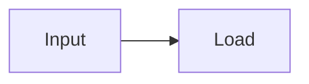

# RelayChat

RelayChat is a small Android client for OpenAI-compatible API relays. It supports multiple providers, model discovery, model switching, Chat Completions, Responses, streaming replies, and encrypted local API key storage.

[**Download the latest APK**](https://github.com/Knight-Murphy/RelayChat/releases/latest/download/RelayChat-latest.apk)

## Features

- Add multiple OpenAI-compatible providers.
- Fetch models from `GET /models` or enter model IDs manually.
- Switch provider and model from the chat header.
- Show a centered "切换模型为 …" notice in the conversation when the selected model changes.
- Stream responses from `/chat/completions` and `/responses`.
- Show the reply's current stage and elapsed time, with expandable provider reasoning and a live
  received-character count while the answer streams. Reply processing history can be expanded
  even when the relay does not return reasoning text.
- Render replies with formatting: headings, lists, quotes, tables, code blocks, bold/italic text and LaTeX math.
- Render model-authored SVG, Mermaid and numeric waveform blocks locally in the chat.
- Run model-authored Python with the Chaquopy CPython runtime embedded in the APK, using local
  NumPy and Matplotlib, then render its code, logs and generated images in an execution card.
- Stop an in-progress response.
- Keep generating replies in a foreground service after leaving the app, and notify when a reply is saved.
- Attach up to 20 images to a message with the image button; they are sent to vision-capable models.
- Edit attached images before sending: draw red marks, erase marks, undo/redo, clear marks, and rotate clockwise.
- Keep several conversations, rename them, and switch between them from the `会话` button.
- Start a fresh conversation directly with the square-pencil icon beside the chat title.
- Save conversations and their images in app-private storage, so chats survive restarts.
- Store API keys encrypted with Android Keystore AES-GCM.

## Build

The project contains standard Gradle files and a no-network fallback build script.

With Android Studio or an online Gradle environment, open the project and run `assembleDebug`.

With an existing Android SDK, build an APK directly:

```powershell
.\build-apk.ps1 -SdkRoot "D:\Android\Sdk"
```

The signed debug APK is written to `dist\RelayChat-debug.apk`.

To build a separate test APK that can be installed alongside the existing app, run:

```powershell
.\build-apk.ps1 -SdkRoot "D:\Android\Sdk" -TestBuild
```

This writes `dist\RelayChat-test.apk` with application ID `com.relaychat.app.debug`
and the launcher name `RelayChat Test`. The Android Studio `debug` variant uses the
same application ID, so `assembleDebug` and Run install a separate test app too.

### Versioning

The Android version is defined once in `version.properties`, and both Gradle and
`build-apk.ps1` use that file:

```properties
versionCode=11
versionName=2.0.0
```

For every installable update, increase `versionCode`; change `versionName` when
the user-visible version should change. The APK must also keep the same
application ID and signing key as the installed version, otherwise Android
cannot install it as an update.

## Install

Enable installation from unknown sources for the file manager or browser you use, then install:

```text
dist\RelayChat-debug.apk
```

The normal APK keeps the existing `com.relaychat.app` application ID. To test without
replacing the installed app, install `dist\RelayChat-test.apk` instead. The test app has
its own private storage, so it starts with an empty configuration and conversation list.

The debug certificate is for local testing. Use a private release keystore before distributing the app.

### Automatic APK releases

Pushing to `main` runs `.github/workflows/release-apk.yml`. The workflow builds the APK,
creates or updates the GitHub Release for the version in `version.properties`, and attaches
both a versioned APK and `RelayChat-latest.apk`. The README download link always points to the
latest release.

The workflow expects four repository Actions secrets:

- `ANDROID_KEYSTORE_BASE64`
- `ANDROID_KEYSTORE_PASSWORD`
- `ANDROID_KEY_ALIAS`
- `ANDROID_KEY_PASSWORD`

Use the same signing key across releases so installed copies can be updated in place. Without
these secrets the workflow stops before publishing instead of producing an incompatible APK.

## Provider setup

1. Open `Settings`.
2. Add a provider and enter its API root, including `/v1` when the relay uses the standard layout.
3. Enter the relay API key.
4. Select `Chat Completions` for broad compatibility or `Responses` when the relay supports it.
5. Fetch models or enter model IDs manually, choose the current model, and save.

Only HTTPS API roots are accepted. A relay can see prompts and responses, so only send data you are comfortable sharing with that provider.

## Images

Use the image button beside the composer to pick up to 20 images from the system picker. A picked image is rotated by its EXIF orientation, scaled so its longest edge is at most 1536 px, and compressed to PNG or JPEG. The compressed bytes are sent as base64 data URLs inside the request: `image_url` parts for Chat Completions and `input_image` parts for the Responses API. The relay and the selected model must accept image input, otherwise the API returns an error. Compressed images are stored in the app's private files directory, so they return with their conversation on the next launch and are deleted together with it.

Tap an attachment thumbnail before sending to open the image editor. Draw red marks, erase
marks, undo or redo mark changes, clear all marks, or rotate the image clockwise by 90 degrees.
Rotation clears existing marks and their undo history. Apply edits with `完成` to replace the
pending attachment with a JPEG, or close the editor to keep the original attachment.

To verify the rotation icon and clockwise image rotation on a disposable Android emulator,
run `assembleDebug`, then `.\tests\icons\run-tests.ps1 -Serial emulator-5554`. The
instrumentation saves screenshots under `build/icon-tests/`.

## Rendering

Replies are styled inside the chat bubble instead of being shown as raw source. Headings, bullet and
numbered lists, block quotes, rules, pipe tables, fenced code blocks, inline code, bold, italic,
strikethrough and links are all recognized. A pipe table becomes a real table: columns are sized
from their widest cell, text wraps inside its own column, the header row is shaded and bold and
`:---:` alignment is honored. A table that is wider than the bubble is squeezed to a floor that
keeps it readable, so no column needs sideways scrolling; a footer under such a table (or a tap
on it) opens a full screen reader where the whole table is fitted to the screen and can be
pinched to zoom and dragged to pan. LaTeX math is converted to readable Unicode text, so
`\left( \dfrac{2x+4}{2x+5} \right)^x` is displayed as `((2x+4)/(2x+5))^x` and
`\lim_{x \to \infty}` as `lim (x → ∞)`. The conversion also runs on LaTeX that arrives without math
delimiters, which is common for relay replies, and it leaves ordinary text alone: `C:\Users\name`,
a lone `$`, and unknown commands such as `\somemacro` are shown unchanged.

While a reply streams, the bubble is re-styled at most every 120 ms so long answers stay responsive,
and the final text is styled once the stream ends. Messages are stored as plain text; only the
display is styled.

Pending replies show preparation, connection, waiting, thinking (when reported by the API), and
answer generation instead of an ellipsis. Elapsed time updates once a second, including while no
text arrives. When a relay returns `reasoning_content` / `reasoning` in Chat Completions or
reasoning text / summary events in Responses, that text appears in a separate muted section with
an expandable header. A live processing timeline shows each observed stage and its duration,
even when no reasoning text arrives. Completed sections start collapsed and remain expandable;
they preserve the timeline and explain when the API did not provide reasoning text.
The provider and model selector also shows an estimated context size for the next request. The
estimate follows the same 40-message window used when sending, includes the system prompt and
pending draft or images, and counts each image as approximately 1K tokens. Actual token counts and
window limits remain provider-specific.
Replies saved by older versions retain their total time but cannot reconstruct unsaved stages.
Reasoning never replaces the answer
body; if only reasoning arrives, the app preserves it and explains that the answer is missing.
Completed replies show their local completion time at the bottom right of the bubble.
Replies from an earlier day include a localized date, and replies from an earlier year also
include the year. The time follows the device's 12-hour or 24-hour setting and is saved with
the conversation.
For non-streaming fallback requests, the status says it is waiting for the complete answer.
These stages reflect events received from the API, rather than an estimated completion percentage.
Times are measured locally: total time starts when sending, and the thinking interval starts when
the API first reports reasoning and ends when answer text arrives. Status, reasoning and timings
are saved with the conversation, including stopped, failed and interrupted replies.

Responses requests ask for `reasoning.summary: auto`. If a relay explicitly rejects that
parameter with HTTP 400 or 422, the app retries without it and remembers that restriction for
the selected endpoint and model during the session. Summaries that arrive in done/completed
events are also captured, and already streamed text is not repeated. Chat Completions accepts
plain reasoning fields and textual `reasoning_details`; encrypted reasoning is not displayed.
A relay that responds to a streaming request with `application/json` is read directly rather
than sending the same request again.

To verify reply progress on a disposable Android emulator, build the test APK and run
`.\tests\progress\run-tests.ps1 -Serial emulator-5554 -TestBuild`. The instrumentation uses
local HTTP fixtures without a relay or API key and saves stage screenshots under
`build/progress-tests/`.

## Local diagrams

Text and reasoning models do not need to return a bitmap to draw in RelayChat. The app appends a
drawing contract to the selected provider's system prompt and asks the model to return a complete
fenced block in one of these formats:

````text
```svg
<svg viewBox="0 0 320 160">...</svg>
```



```waveform
{"title":"Ud","xLabel":"omega t","yLabel":"V","series":[
  {"name":"Ud","color":"#246b8a","points":[[0,0],[1,1.2],[2,0]]}
]}
```
````

SVG is best for precise circuits and mathematical geometry. Mermaid is best for flows, sequences
and relationships. Waveform JSON is best for electrical curves: each series contains numeric `x`
and `y` points and may set `step` to `true` for a digital signal. `chart` and `plot` are accepted as
aliases for `waveform`.

Diagrams render entirely on the device and do not call an image-generation service. Mermaid is
bundled in the APK, SVG is restricted to a safe drawing subset, and WebViews have network, file and
content access disabled. Tap a drawing to open it full screen; tap and zoom controls are available
there. A malformed or unsupported block falls back to its source instead of showing a blank area.
Long-press a drawing in the conversation to copy its source.

To verify all three renderers and their error fallback on a disposable emulator, build the test APK
and run `.\tests\diagrams\run-tests.ps1 -Serial emulator-5554`. Screenshots are saved under
`build/diagram-tests/`.

## Python execution

Python 3.12, NumPy and Matplotlib are bundled through Chaquopy and run on the Android device.
Both Chat Completions and Responses providers can use this capability; the relay does not need a
server-side code interpreter tool. RelayChat appends a local-execution contract to the system
prompt, extracts the first complete `python` fenced block from the model reply, and runs it in an
empty per-request temporary directory.

`print()` output and Python tracebacks are captured. `plt.show()` and `savefig()` outputs are
stored with the conversation, shown in an expandable `执行 Python 代码` card, and can be opened in
the full-screen image viewer. The runtime restricts the working directory and image collection to
the app cache, but it is not a hardened security sandbox. Model-authored code therefore has the
same Android app-process permissions as RelayChat.

To verify embedded CPython startup, stdout and traceback capture, `plt.show()`, `savefig()`,
end-to-end reply execution, image display, code-block folding and persistence, build the test APK
and run `.\tests\python\run-tests.ps1 -Serial emulator-5554`. Screenshots are saved under
`build/python-tests/`.

## Conversations

Use the `会话` button in the chat header to open the conversation list. Empty conversations are not shown or saved; the current blank conversation remains only as the input buffer for a new message. Each row shows only its title, message count and an active-conversation badge. Tap a row to open it, or long-press it to show a preview and the `打开`, `重命名` and `删除` menu. The active conversation shows a disabled `当前对话` action instead of `打开`. Tap outside the menu or press Back to dismiss it. `新建` starts a fresh conversation, `重命名` gives a conversation a name of its own, and `删除` removes one after a confirmation. The header shows the title of the active conversation, which is derived from its first user message until it is given a name in the list. Saving an empty name clears the custom name and restores the automatic title. Switching is blocked while a reply is streaming.

To verify the compact list and long-press actions on a disposable emulator, run `assembleDebug`,
then `.\tests\conversations\run-tests.ps1 -Serial emulator-5556`. The instrumentation checks taps,
long-presses, scrolling, menu dismissal, renaming, delete confirmation, bottom-row placement,
the quick-create icon, empty-conversation reuse, the streaming guard and header layout,
and saves screenshots under `build/conversation-tests/`.

Conversations are saved to the app's private files directory on every message, conversation switch and app stop, and are restored on the next launch. Empty conversations are discarded during cleanup. The metadata lives in `conversations.json` and each image is written as a separate file under `images/`, so appending a message never rewrites the image payloads.

Replies run in a foreground service independently of the chat screen. Returning home, closing the
chat Activity, or removing the task from Recents does not cancel a reply. A low-priority notification
shows that generation is running and provides a Stop action. Received text is saved roughly once a
second; the final answer is saved before the service exits. Opening the app again shows the current
progress or the saved result, without sending the request again. A separate completion notification
alerts the user and opens the completed conversation when tapped. Allow notifications when prompted
on Android 13 or later to receive completion alerts.

On the first send, the app also offers a background-running setup prompt. Allow the system's
battery-optimization exemption and, if the phone provides a separate setting, set RelayChat's
battery usage to Unrestricted. Until these restrictions are removed, the chat selector shows a
tap-to-configure reminder. A foreground service and a CPU wake lock alone do not exempt a
connection from Doze network restrictions. The reply service holds a Wi-Fi lock only while
generating, and releases both locks on completion, cancellation or shutdown. Reply reads allow
up to 15 minutes without incoming data, while model discovery keeps a 30-second read timeout.
Network timeouts retain partial text and show an actionable explanation instead of raw `timeout`.

Force-stopping the app, stopping it from Android's active-apps controls, losing connectivity, or
system/OEM process termination can still interrupt a live connection. After a process restart, an
unfinished answer keeps its saved partial text and shows an interruption notice; it is never
automatically replayed. Android's foreground-service time limit is handled by ending the request
and keeping the received text.

Chat history is stored as plain text in that private directory; only the API keys use Android Keystore encryption, and `android:allowBackup="false"` keeps the directory out of system backups.
